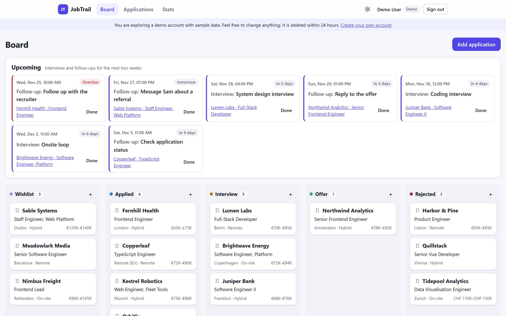
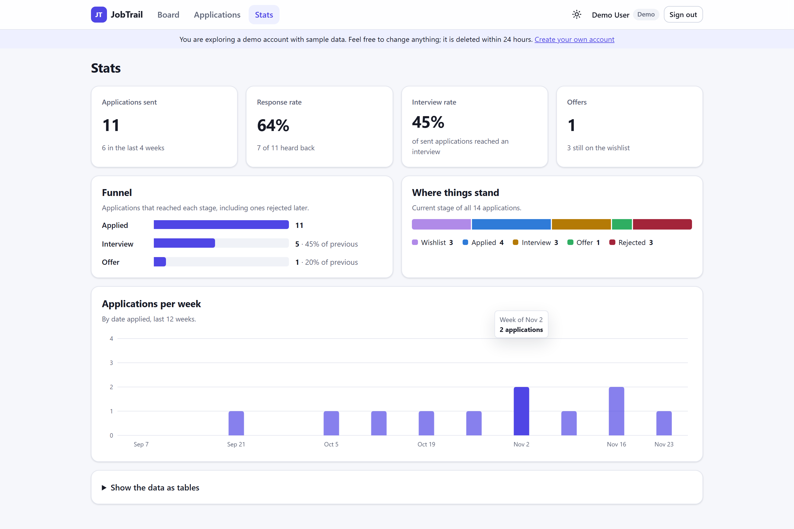
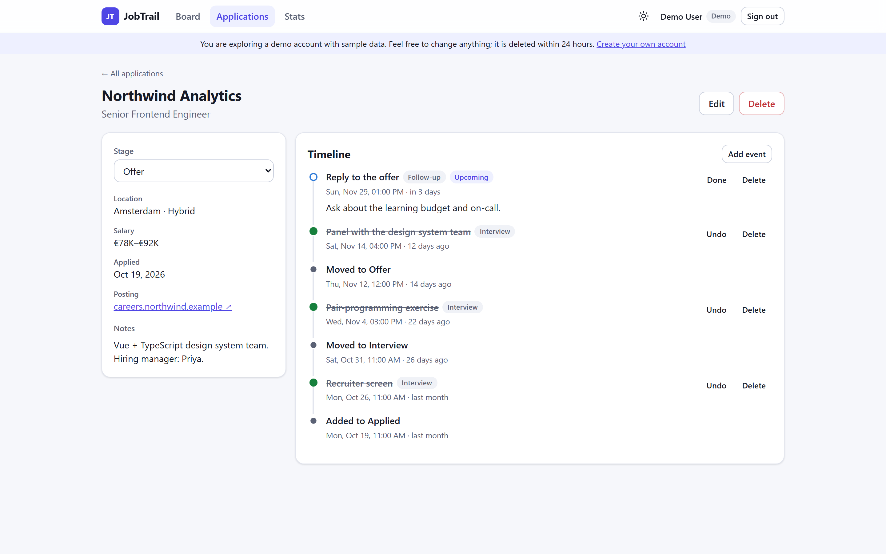
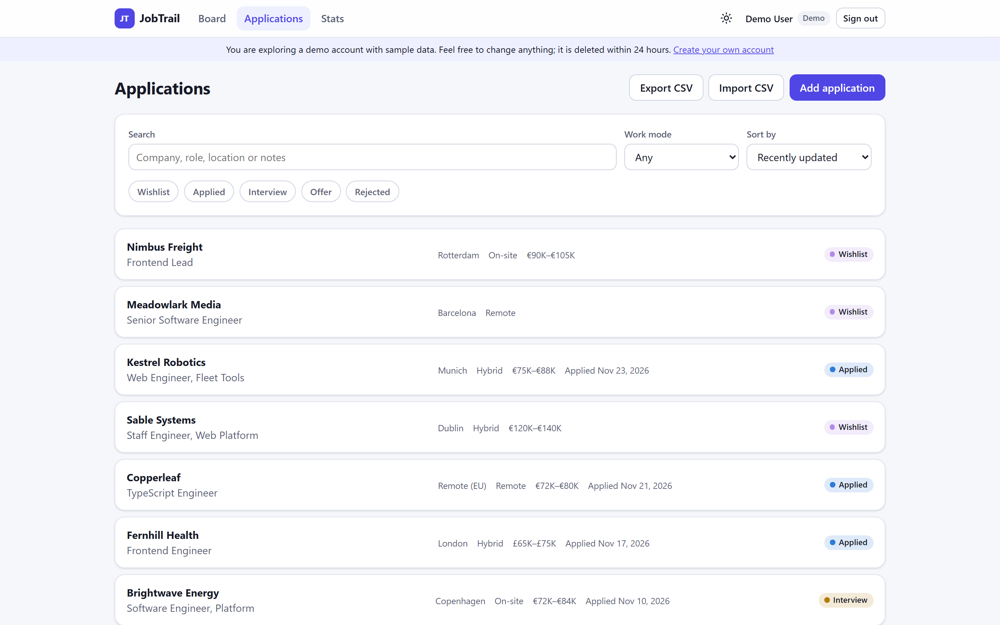
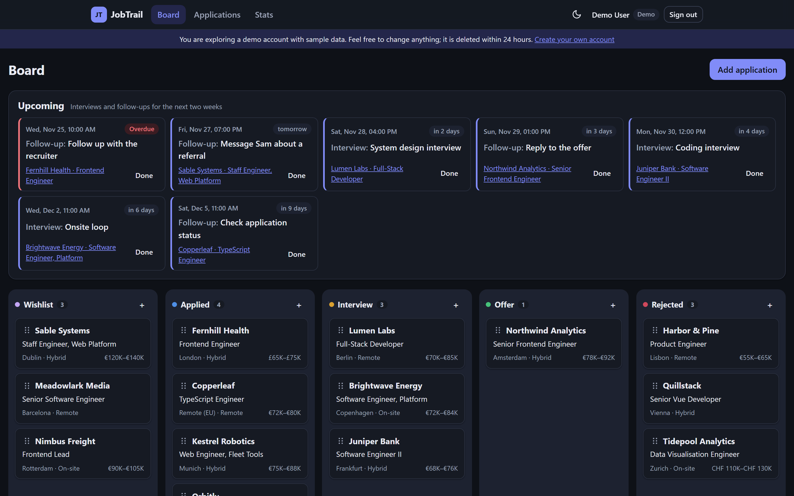
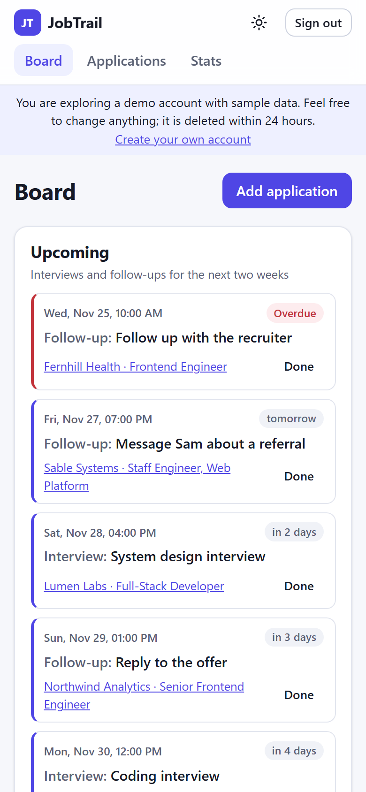

# JobTrail

[](https://github.com/Shgabnaz1377/jobtrail/actions/workflows/ci.yml)
[](LICENSE)

A job application tracker. JobTrail puts every application on a kanban board, from Wishlist to Offer. Each application keeps a timeline of interviews and follow-ups, an **Upcoming** panel shows what's due, and a stats page shows how the search is actually going.

Built with **Nuxt 4**, **Vue 3**, **TypeScript**, **Postgres** and **Drizzle ORM**. Locally it runs on an in-process Postgres (PGlite), so you need nothing but Node to try it.



## Features

- **Kanban board**: Wishlist → Applied → Interview → Offer → Rejected. Move cards by
  - dragging them with the mouse,
  - using the **keyboard**: focus a card's handle, <kbd>Space</kbd> to pick it up, arrow keys to move, <kbd>Space</kbd> to drop, <kbd>Esc</kbd> to cancel (each step is announced to screen readers), or
  - using a stage picker on touch and small screens.
- **Applications**: company, role, posting link, salary range and currency, location, on-site/hybrid/remote, stage, applied date and notes. Includes **search**, stage and work-mode **filters** and sorting. Filters are kept in the URL.
- **Timeline per application**: interviews, follow-ups and notes, plus stage changes recorded automatically.
- **Upcoming panel**: open interviews and follow-ups for the next 14 days, with overdue items flagged.
- **Stats**: response rate, interview rate, a funnel with conversion between stages, current stage breakdown, and applications per week. Every chart has a table view.
- **CSV import/export**: import is all-or-nothing with errors reported by line, and export is safe against spreadsheet formula injection.
- **Try the demo**: one click creates a private sample account, which is deleted after 24 hours.
- **Dark mode** (system, light or dark, with no flash on load), a **responsive** layout, and attention to **accessibility**: labelled controls, live regions, a skip link, and stage colours checked for colour-vision deficiency.

| Stats | Application timeline |
| --- | --- |
|  |  |

| Applications list | Dark mode | Mobile |
| --- | --- | --- |
|  |  |  |

All screenshots are captured from the running app by [`scripts/screenshots.mjs`](scripts/screenshots.mjs), using the same demo data visitors get.

## Architecture

```
app/                     Vue front end (Nuxt 4 app directory)
  pages/                 board, applications (list/new/detail/edit), stats, login, register
  components/            KanbanBoard, KanbanCard, ApplicationForm, ApplicationTimeline, stats/*
  utils/board.ts         pure board logic: grouping, moves, keyboard targets, drop index
  middleware/            global auth guard
server/
  api/                   Nitro route handlers (thin: auth → validate → call lib)
  lib/                   domain logic, every function scoped by userId
  db/schema.ts           Drizzle schema · db/migrations: generated SQL
  utils/                 useDb(), requireUser(), zod body/query helpers, error mapping
shared/                  code used by both sides: constants, zod schemas, CSV parser
test/
  unit/                  server logic and pure helpers against in-memory PGlite
  nuxt/                  component tests (@nuxt/test-utils + happy-dom)
  api/                   HTTP tests against a built server, incl. cross-user isolation
e2e/                     Playwright smoke test against the production build
```

**Request flow.** A route handler calls `requireUser(event)`, which unseals the session cookie and checks the user still exists. The handler then parses input with the shared zod schema and calls a function in `server/lib`. Every query in `server/lib` filters on `user_id`, including bulk updates and joins. If an id belongs to someone else, the response is `404`, the same as for an id that doesn't exist.

**Database.** `useDb()` picks the driver at runtime:

| Environment | Driver | Notes |
| --- | --- | --- |
| Production (`DATABASE_URL` set) | `@neondatabase/serverless` over HTTP | Migrations run separately with `npm run db:migrate`. |
| Local dev | PGlite in `.data/pglite` | Migrated automatically on first use. |
| Tests | PGlite `memory://` | A fresh database for every test file or server. |

The Neon HTTP driver has no interactive transactions. Writes that need several rows changed together are therefore single statements: board moves use `UPDATE … SET position = CASE …`, and CSV import uses bulk `INSERT`s. Running on Vercel without `DATABASE_URL` is a hard error, not a silent fallback to an ephemeral disk.

**Auth.** Email and password, hashed with scrypt. Sessions are sealed cookies via [`nuxt-auth-utils`](https://github.com/atinux/nuxt-auth-utils). Login runs a hash verification even for unknown emails, so response timing doesn't reveal which emails have accounts.

**Stage history.** Every stage change writes a `status_change` event. The funnel counts the furthest stage each application *reached*, so an application that was interviewed and then rejected still counts as an interview.

**Demo accounts.** `POST /api/auth/demo` creates a flagged user with a random, never-revealed password and seeds it with sample data. `GET /api/cron/cleanup-demo` deletes demo users older than 24 hours, and cascades remove their data. Vercel Cron calls it daily (see [`vercel.json`](vercel.json)). Starting a new demo also cleans up expired ones.

## Local development

Requires **Node 24**.

```bash
npm install
npm run dev            # http://localhost:3000
```

That's all. PGlite stores data in `.data/pglite`, and `nuxt-auth-utils` generates a dev session secret into `.env` on first run. Copy `.env.example` to `.env` if you want to set things explicitly.

| Script | What it does |
| --- | --- |
| `npm run lint` | ESLint (`@nuxt/eslint`, stylistic rules) |
| `npm run typecheck` | `nuxt typecheck` (vue-tsc) |
| `npm test` | Vitest: unit, component and HTTP API suites |
| `npm run build` | Production build into `.output/` |
| `npm run test:e2e` | Playwright smoke test (run `npm run build` first) |
| `npm run db:generate` | Generate a migration after changing `server/db/schema.ts` |
| `npm run db:migrate` | Apply migrations to `DATABASE_URL`, or to local PGlite if unset |
| `npm run docs:screenshots` | Recreate `docs/screenshots` from a running server (`BASE_URL`) |

### Tests

- `test/unit`: domain logic against a real (in-memory) Postgres: search and filters, moves and renumbering, the stats maths, CSV, demo seeding and cleanup.
- `test/nuxt`: components: the form's validation, keyboard moves on the board (including a race with background refreshes), and the charts.
- `test/api`: builds the app and talks to it over HTTP with separate cookie jars. This includes a suite showing that **user B cannot list, search, read, update, move or delete user A's applications or events**, or see them in stats, reminders or CSV export.
- `e2e/smoke.spec.ts`: register → add an application → drag it to Interview → keyboard-move it to Offer → reload and check, failing on any browser console error.

CI (`.github/workflows/ci.yml`) runs lint, typecheck, tests and build in one job and the Playwright smoke test in another.

## Deploying to Vercel

The app deploys as a standard Nuxt project. Vercel detects Nuxt and uses its Nitro preset, and the Node version comes from `"engines": { "node": "24.x" }`.

1. **Create a Postgres database** on [Neon](https://neon.tech), directly or through the Vercel Marketplace integration. Copy its connection string (`postgresql://…?sslmode=require`).
2. **Apply the migrations** once, from your machine:
   ```bash
   DATABASE_URL="postgresql://…" npm run db:migrate
   ```
   Run it again after pulling changes that add migrations.
3. **Import the repository** in Vercel (*Add New → Project*). The framework preset is Nuxt, and the build command and output need no changes.
4. **Set environment variables** for Production (and Preview if you use it):

   | Variable | Required | Value |
   | --- | --- | --- |
   | `DATABASE_URL` | yes | The Neon connection string |
   | `NUXT_SESSION_PASSWORD` | yes | A random string of **at least 32 characters**, e.g. `node -e "console.log(require('crypto').randomBytes(32).toString('hex'))"` |
   | `CRON_SECRET` | recommended | Any random string. Vercel Cron sends it as `Authorization: Bearer …` to `/api/cron/cleanup-demo`, and the route refuses to run without it. |

5. **Deploy.** The cron in `vercel.json` (`0 4 * * *`, daily, which the Hobby plan allows) starts removing demo accounts older than 24 hours.

## Notes

- `vue-router` is pinned to `5.5.1` through `overrides`. Version `5.5.2` references the `__VUE_OPTIONS_API__` flag in its Node build without defining it, which breaks every server-rendered page. Remove the pin once a fixed release ships.
- The board's drag and drop uses the native HTML5 API. Touch devices get the stage picker instead.

## License

[MIT](LICENSE)
